

  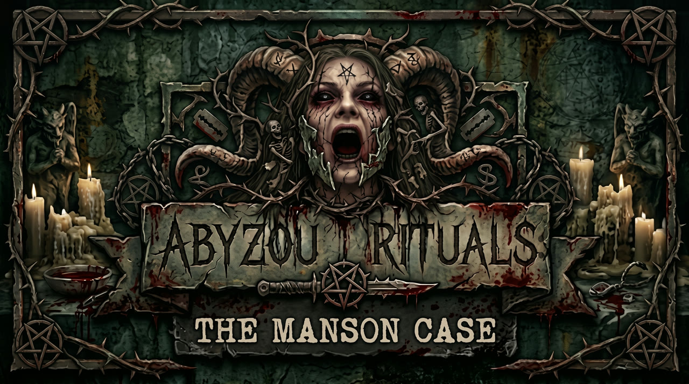

# Abyzou Rituals: The Manson Case — Portafolio técnico

**Juego de terror psicológico en primera persona · Unreal Engine 5 · Publicado en Steam y Epic Games Store**

🎮 **[Ver en Steam](https://store.steampowered.com/app/5295730/Abyzou_Rituals_The_Manson_Case/)**

Este repositorio es una **muestra de mi trabajo** en *Abyzou Rituals: The Manson Case*, un juego independiente desarrollado por un equipo de dos personas. Fui **programador principal, diseñador técnico y desarrollador de gameplay e interfaces**.

> ⚠️ **Este repositorio no contiene el código fuente, los Blueprints ni los assets del juego.** La propiedad intelectual del juego pertenece a su director y productor, Manuel Ignacio Albuja Bustamante. Aquí solo se incluye material audiovisual de presentación (capturas, GIFs y arte) para mostrar los sistemas que desarrollé.

---

## 🕯️ Sobre el juego

En 2013, la Casa 12 fue escenario de una masacre y de un ritual satánico que nunca terminó. El jugador entra sin armas, solo con una linterna y una videocámara, para descifrar símbolos, encontrar cintas VHS y completar el ritual de destierro antes de que Abyzou lo encuentre.

  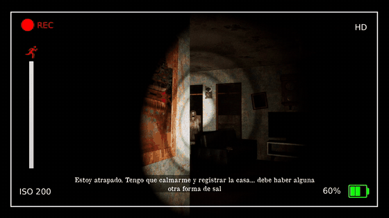
  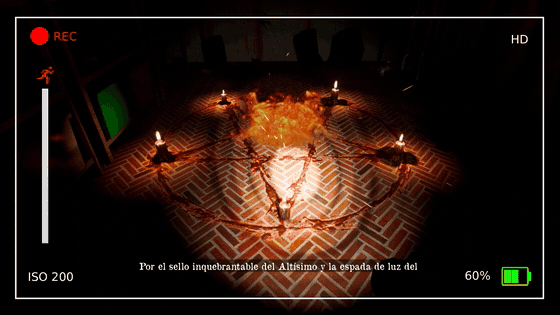

---

## 🛠️ Lo que desarrollé

### Gameplay en primera persona
- Locomoción, gestión de **estamina/fatiga** y cámara dinámica estilo videocámara (HUD de grabación, ISO, batería).
- Clase base modular de objetos interactivos (`BP_ObjetoBase`) con detección continua de colisiones (CCD), inspección en tiempo real y examen de evidencias.
- Puertas interactivas con animación por **Timelines** y detección de proximidad.
- **Puzles contextuales:** candados combinatorios de 4 dígitos, contenedores con claves numéricas y sellos de destierro.

  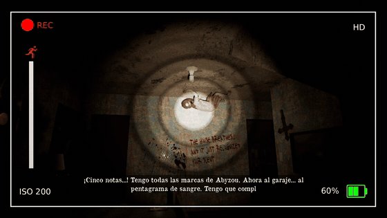
  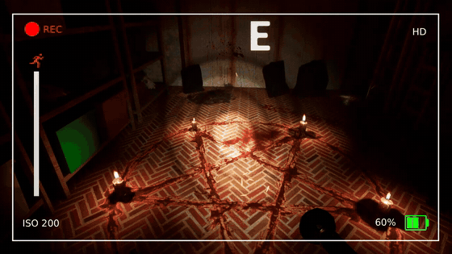

### Inteligencia artificial de las entidades
- Controlador de IA con **Behavior Trees** y **Blackboards**.
- **AIPerception** con estímulos visuales y auditivos.
- Patrullaje adaptativo en **NavMesh**, persecución en tiempo real y muerte inmediata al ser atrapado.

  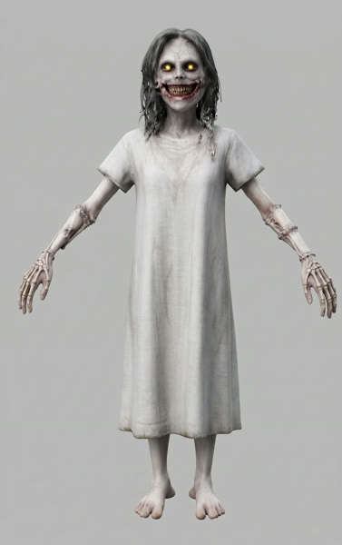
  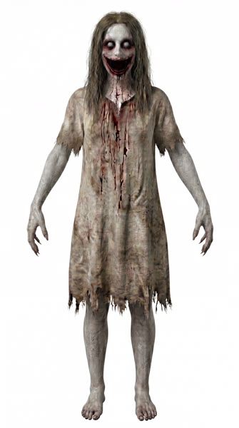
  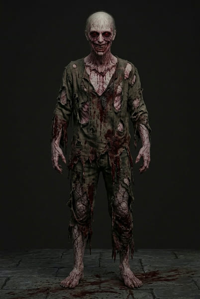

### Interfaces (UMG)
- Menú principal, menú de pausa y pantallas de confirmación.
- Inventario en cuadrícula (`Uniform Grid Panel`) basado en estructuras de datos.
- Sistema de notas y expedientes, ajustes gráficos y de audio.

### Narrativa, audio y cinemáticas
- Cintas VHS y secuencias de terror psicológico con **Sequencer**.
- Audio posicional 3D, música adaptativa en persecuciones y eventos acústicos de tensión.
- Sistema de objetivos y subtítulos.

  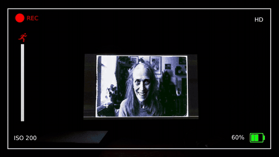

### Optimización y publicación
- Perfilado de rendimiento, depuración de bugs de gameplay, colisiones, guardado y lógica de estado.
- Empaquetado de builds de distribución (Shipping) para **Steam** y **Epic Games Store**.

---

## 📸 Capturas

| | |
|---|---|
| 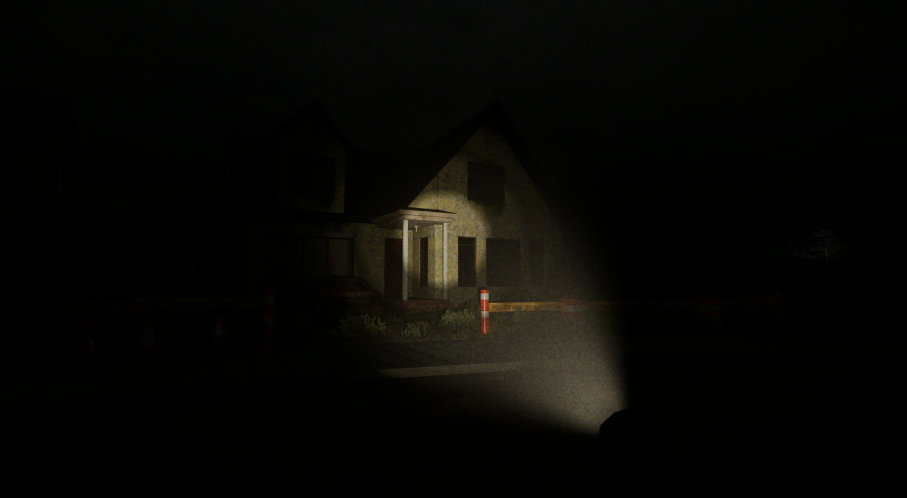 | 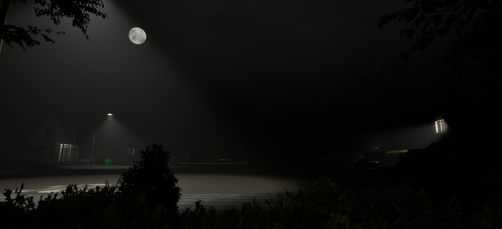 |
| 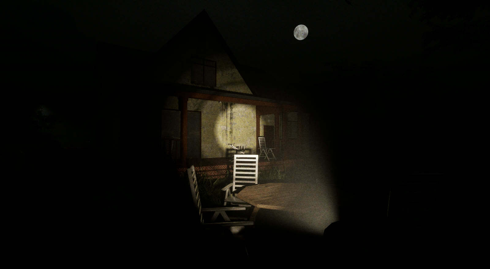 | 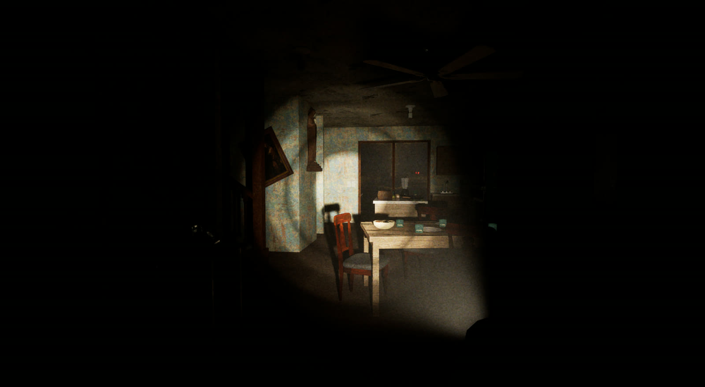 |
| 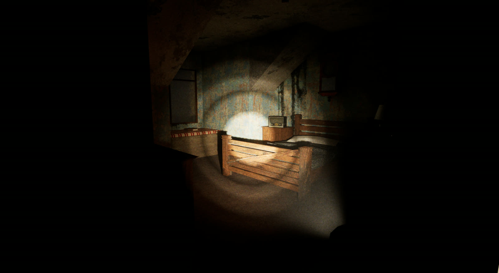 | 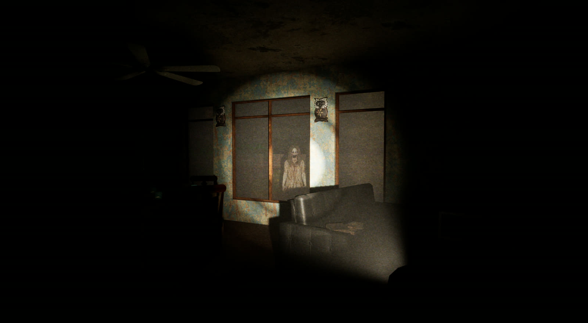 |
| 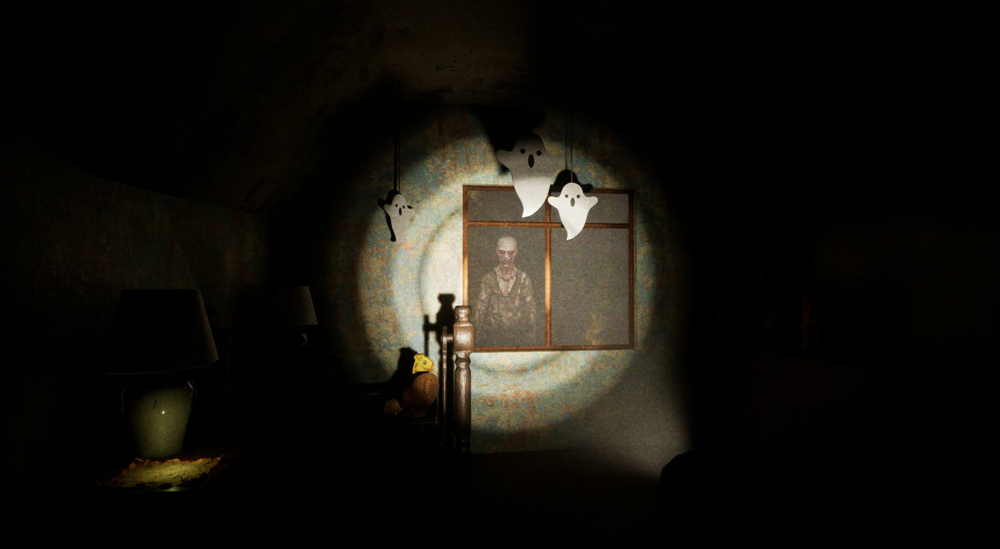 | 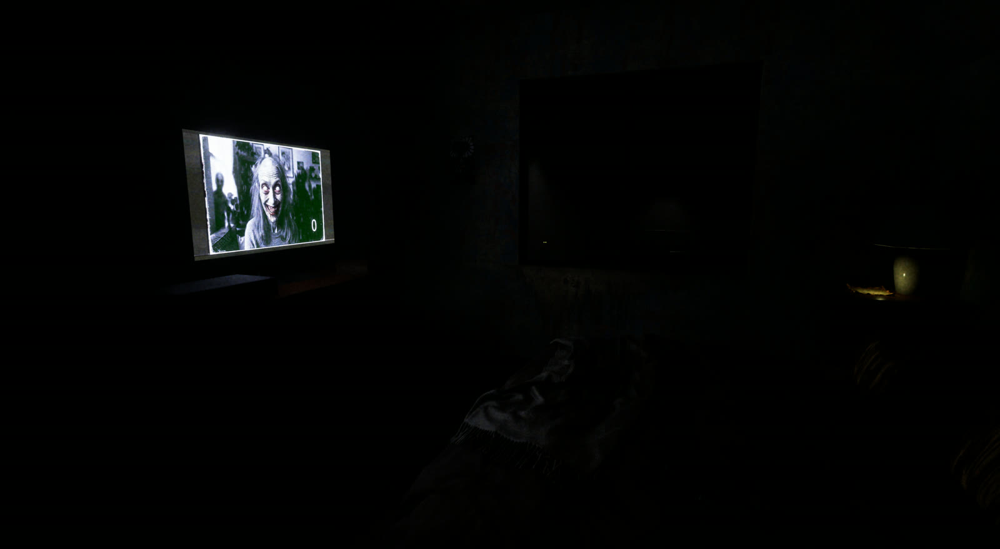 |

---

## 🧰 Tecnologías

`Unreal Engine 5` `Blueprints` `Behavior Trees` `AIPerception` `NavMesh` `UMG` `Sequencer` `Timelines` `Blender`

## 👤 Créditos

- **Director, productor y titular de los derechos:** Manuel Ignacio Albuja Bustamante
- **Programador principal, diseñador técnico y desarrollador de gameplay e interfaces:** Anthony Pombosa

---

## 🌎 English summary

Technical portfolio for **Abyzou Rituals: The Manson Case**, a first-person psychological horror game built in **Unreal Engine 5** by a two-person team and released on Steam and Epic Games Store. I was the **lead programmer and technical designer**: first-person gameplay, interactive objects and puzzles, enemy AI (Behavior Trees, Blackboards, AIPerception, NavMesh), UMG interfaces and inventory, Sequencer-driven horror sequences, 3D audio, optimization and shipping builds.

This repository contains **presentation media only** (screenshots, GIFs and art). It does not include the game's source code, Blueprints or assets, which belong to the game's owner.

📫 [LinkedIn](https://www.linkedin.com/in/anthony-pombosa-25006a168) · [GitHub](https://github.com/Tonypbz)
